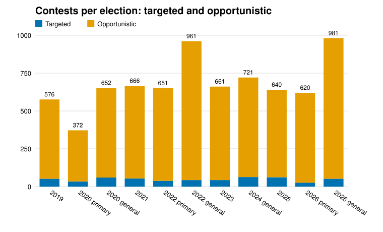

class: center, middle

## Evidence and Best Practices from Colorado Audits

### Over 7,000 contests in a decade

Neal McBurnett, Lori Stevens, John Caron, Mike Raisch

EVT/WOTE 2026

???
15 minutes in all: about 11 of talk, 4 for questions.

To display locally, run `view-presentation`.
To make a PDF: `decktape http://localhost:8000/#1 evt-wote-2026.pdf`

---
## Why this matters now

* Risk-limiting audits are under attack from skeptics
* Officials trusting the audit is not enough
* The public needs to be able to check it for itself

**Goal:** move Colorado from *officials trust the audit*
to *anyone can verify it*

---
## How Colorado audits

* Every ballot is scanned; the **cast vote record (CVR)** records every vote
* A public dice roll seeds the random sample
* Audit boards read each sampled ballot card and compare it with its CVR row

So **every contest on a sampled card** is compared,
not just the targeted ones

???
Targeted contests drive the sample size; the rest are compared "opportunistically".
An audit of a contest is not the same as a risk-limiting audit of it.

---
## A decade of ballot-level evidence

Over **7,000 contests** since 2019, about **475 targeted**

???
6,520 contests from 2019 to the 2026 primary (2020 presidential's 2 omitted), plus about 1,000 in this week's 2026 general.
Source: the paper's Table 1, from its rebuilt cross-election database (to be published).

---
## What the data show

* **965,254** contest comparisons; **637** discrepancies (0.066%)
* Rates vary about twentyfold between elections
* Ten years: four contests needed a 3rd round, one a 4th
* Causes: audit boards' data-entry slips, occasional wrong ballots
  (voters' overvotes, entered as marked, are not discrepancies)

**But:** the evidence was scattered and short-lived;
we had to mirror and rebuild it

???
Discrepancies: o2/o1 overstatements and u1/u2 understatements, Kaplan-Markov typing matching CORLA's rule.
Mirror: github.com/nealmcb/auditcenter, files kept since 2017 at the Audit Center's own paths.

---
## The 2026 pilots: verifiable observation

* All evidence **committed before the dice roll**:
  signed (Sigstore), timestamped (OpenTimestamps), published
* **Redacted CVRs** from La Plata, Morgan and Weld
* Observers checked each ballot read aloud against the CVR
* Targeted and style-based extra draws

???
Thanks to the clerks: Tiffany Lee (La Plata), Carly Koppes (Weld), Kevin Strauch (Morgan).

---
## What observers found

* 71 targeted contests: 69 met the risk limit in round 1, 2 in round 2
* In Weld, the redacted CVR matched CORLA's own CVR
  on every audited card: **5,980 of 5,980** choices
* Observers' records: signed on their own devices,
  checkable without trusting our software

???
The Weld check uses CORLA's published round comparison file.
Write-up: docs/CLI_OBSERVER_SI.md in github.com/nealmcb/corla-observer

---
## Best practices and what's next

* **Commit** the audit's inputs publicly before the seed
* **Redact automatically** (anonymize_cvr) and publish no small counts
* **Style-based RLAs**: cover more contests with less work
* **Independent observers** with verifiable records

???
anonymize_cvr 0.4.0: precinct redaction by default, rare contests and rare ballot types redacted.

---
class: center, middle

## Thanks

Matt Crane (CCCA), the clerks of La Plata, Morgan and Weld,
and the Colorado Secretary of State's office

github.com/nealmcb/corla-observer
github.com/nealmcb/anonymize_cvr
github.com/nealmcb/auditcenter

sites.google.com/view/auditenhancement

<!-- paper tables: start (make_paper_slides.py) -->
---
class: paper-table, wide
### From the paper: Table 1

| Election | Total contests | Directly targeted | Opportunistically named | No comparison record | Single-county | Partial multi-county | Statewide |
|---|---:|---:|---:|---:|---:|---:|---:|
| 2019 | 576 | 52 | 498 | 26 | 457 | 117 | 2 |
| 2020 (general) | 652 | 60 | 520 | 72 | 510 | 142 | 0 |
| 2020 (presidential) | 2 | 2 | 0 | 0 | 0 | 0 | 2 |
| 2020 (primary) | 372 | 34 | 304 | 34 | 282 | 87 | 3 |
| 2021 | 666 | 54 | 588 | 24 | 537 | 127 | 2 |
| 2022 (general) | 961 | 43 | 871 | 47 | 801 | 135 | 25 |
| 2022 (primary) | 651 | 38 | 604 | 9 | 543 | 96 | 12 |
| 2023 | 661 | 43 | 542 | 76 | 511 | 148 | 2 |
| 2024 | 721 | 63 | 597 | 61 | 555 | 142 | 24 |
| 2025 | 640 | 62 | 541 | 37 | 515 | 124 | 1 |
| 2026 | 620 | 26 | 580 | 14 | 512 | 97 | 11 |
| **Total** | **6,522** | **477** | **5,645** | **400** | **5,223** | **1,215** | **84** |

???
Caption: Contest coverage classification by election, and by county span.

From the paper (04-coverage.md): Across the full survey (the table), **6,122 of 6,522 contests (93.9%) have at least one examined-ballot comparison record named in CORLA's own export**: 477 (7.3%) by direct targeting, and 5,645 (86.6%) purely as a byproduct of some other contest's draw. The remaining 400 contests (6.1%) have no name-matched comparison record in the export for that election. Directly targeted contests are consistently a small minority of the total — never more than about 10%, and often closer to 4% in the larger general elections, where the number of small down-ballot contests grows faster than the number of contests formally selected to drive sampling.

---
class: paper-table
### From the paper: Table 2

| Election | County-level targets | Statewide targets |
|---|---:|---:|
| 2019 | 63/63 | 1/1 |
| 2020 (general) | 63/63 | 3/3 |
| 2020 (presidential) | 0/0 (blocked) | 0/0 (blocked) |
| 2020 (primary) | 88/88 | 1/1 |
| 2021 | 63/64 | 0/0 (blocked) |
| 2022 (primary) | 80/80 | 2/2 |
| 2022 (general) | 63/63 | 6/6 |
| 2023 | 63/63 | 1/1 |
| 2024 | 63/63 | 2/2 |
| 2025 | 73/73 | 2/2 |
| 2026 | 112/112 | 1/1 |

???
Caption: Selection-reproduction results by election.

From the paper (05-verification.md): Across the eleven election instances where the necessary files exist (the earliest three instances predate the file formats this check requires, per §3.1), **750 of 751 checkable targets — 99.9% — reproduce the audit software's own official selection exactly: zero ballots missing, zero extra**, for every target but one. Results by election appear in the table. As §5.1 introduces, this table counts targets, not deduplicated contests as in §4 — a single county-level contest name run independently by, say, twenty counties contributes twenty targets here, so the two tables' totals are not meant to be compared directly.

---
class: paper-table
### From the paper: Table 3

| Source | o2 | o1 | u1 | u2 | Total |
|---|---:|---:|---:|---:|---:|
| CORLA's own reported count | 18 | 8 | 12 | 8 | 46 |
| Independently derived | 18 | 8 | 12 | 8 | 46 |

???
Caption: Typed-discrepancy validation across just the 477 formally targeted contests: independently derived counts against CORLA's own reported counts, matching exactly.

From the paper (05-verification.md): As a secondary, independent validation channel, a typed-discrepancy check — comparing the count of each Kaplan-Markov discrepancy category (two-vote and one-vote overstatements and understatements, `o2`/`o1`/`u2`/`u1`; §6.2 reports what these mean and finds substantively) independently derived from the normalized per-ballot comparison data against the audit software's own reported counts for the same categories, contest by contest — matches exactly for every one of the 477 formally targeted contests where both counts exist (the table), a check that exercises a different part of the pipeline (per-ballot comparison parsing rather than PRNG reconstruction) and corroborates the same conclusion from an independent angle.

---
class: paper-table
### From the paper: Table 4

| Election | o2 | o1 | u1 | u2 | Total | Examined | Rate |
|---|---:|---:|---:|---:|---:|---:|---:|
| 2018 general | 6 | 3 | 0 | 3 | 12 | 164,796 | 0.0073% |
| 2020 (primary) | 16 | 4 | 4 | 16 | 40 | 61,546 | 0.0650% |
| 2020 (general) | 59 | 68 | 85 | 47 | 259 | 234,333 | 0.1105% |
| 2020 (presidential) | 0 | 0 | 0 | 0 | 0 | 155 | 0.0000% |
| 2021 | 5 | 11 | 11 | 5 | 32 | 60,597 | 0.0528% |
| 2022 (primary) | 6 | 8 | 5 | 7 | 26 | 118,827 | 0.0219% |
| 2023 | 5 | 3 | 9 | 2 | 19 | 35,486 | 0.0535% |
| 2024 | 47 | 52 | 71 | 55 | 225 | 149,272 | 0.1507% |
| 2025 | 4 | 6 | 4 | 3 | 17 | 47,706 | 0.0356% |
| 2026 (primary) | 5 | 0 | 0 | 2 | 7 | 92,536 | 0.0076% |
| **Overall** | **153** | **155** | **189** | **140** | **637** | **965,254** | **0.0660%** |
| Overall rate | 0.0159% | 0.0161% | 0.0196% | 0.0145% | — | — | 0.0660% |

???
Caption: Two- and one-vote overstatement (o2/o1) and one- and two-vote understatement (u1/u2) discrepancy counts and rates by election. 2019 coordinated and 2022 general are excluded here (source data not further categorized -- §6.4); 2017 pilot, 2018 primary, and 2020 presidential's own predecessor formats have no comparison data at all (§3.1).

From the paper (06-discrepancies.md): Across every election with ballot-level comparison data (2018 general plus every "contest CSV"-era election, ten instances in all — §3.1), **637 genuine discrepancies were found across 965,254 examined contest-ballot comparisons, an overall rate of 0.066%** — broken down by Kaplan-Markov type and by election in the table.

---
class: paper-table
### From the paper: Table 5

| Election | Independently re-derived | Previously published | Gap |
|---|---:|---:|---:|
| 2020 (primary) | 119 | 122 | −3 |
| 2020 (general) | 276 | 280 | −4 |
| 2021 | 38 | 44 | −6 |
| 2022 (primary) | 86 | 93 | −7 |
| 2023 | 22 | 22 | exact |
| 2024 | 235 | 235 | exact |
| 2025 | 22 | 22 | exact |
| 2026 (primary) | 16 | 16 | exact |
| **Total** | **814** | **834** | **−20** |

???
Caption: Reconciliation of the independently re-derived discrepancy-report row counts against an earlier published tally of the same eight elections.

From the paper (06-discrepancies.md): A from-scratch re-derivation of the same underlying Secretary of State reports, performed independently of an earlier published tally of the same eight elections, reproduces four of the eight exactly but comes up 20 rows short across the other four (814 versus 834 total, a 2.4% gap):

<!-- paper tables: end -->
